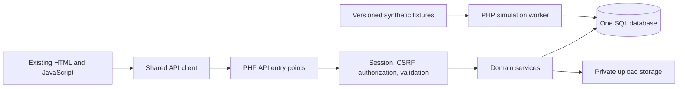
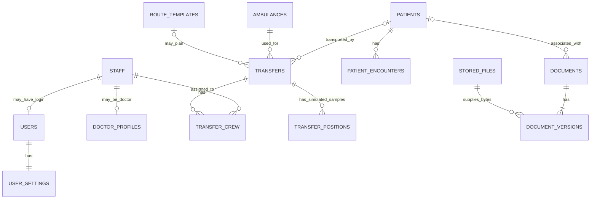

# Unified hospital backend: implementation guide

Prepared: 12 October 2026. Companion analysis: [backend-analysis.md](backend-analysis.md).

This roadmap preserves the original target architecture and phase plan. Current implementation (20 October 2026) includes identity/account administration, email password recovery, settings, documents with patient file QR access, transfers/simulation, the six management catalogs and surveys (schema 001–014). Migration 014 adds the two institution choices for the existing Settings facility preference without changing table structure or permissions. Complete JSON-based Spanish/English interface translation is integrated using the existing SQL locale preference, shared browser/PHP dictionaries and the current API contracts. Both light/dark appearance modes use the existing SQL theme preference. Calendar/appointment management and reports remain deferred; appointment counts are read-only. AGENTS.md and api-contracts.md take precedence for completed behavior and deliberate changes to the original plan, including console-only errors. Recovery uses Brevo with a verified sender; the user will configure that provider later. Administrator-assisted recovery remains available.

## Target and working decisions

Build one PHP application using the existing frontend, a single relational database, private server file storage, and JSON APIs. Run it locally through XAMPP. All account holders are hospital staff; all sample patients, documents, and ambulance positions used for development are test data.

“Real time” in this scope means multiple authenticated viewers see the same server-generated ambulance simulation with short update intervals and visible freshness. It does not mean actual emergency dispatch, phone tracking, or live GPS integration.

Working defaults below make the guide implementable. Staff approval rules, exact role names, session limits, and document permissions should be recorded as project decisions before their dependent endpoint is built.

| Decision | Recommended default |
| --- | --- |
| Application structure | Modular PHP monolith: shared infrastructure, separate domain modules, one deployment |
| SQL engine | Target the actual engine bundled with XAMPP; use InnoDB, foreign keys, `utf8mb4`, migrations |
| Account admission | Registration creates a pending account; an administrator verifies/links staff and approves access |
| Browser authentication | Server-side PHP sessions and same-origin cookies |
| API location | One URL base `/api/v1/`, exposed by Apache Alias; all PHP entry points and implementation live under `backend/php/`, per the implementation request |
| API field names | Consistent English `snake_case`; Spanish labels remain in the UI |
| Persistence | SQL for structured records; private disk files for uploads; JSON for transport, contracts, and non-sensitive fixtures |
| Tracking transport | Poll a shared snapshot about every 3 seconds; add SSE only if a later requirement justifies it |
| Simulation source | One explicitly started PHP CLI worker writes synthetic positions into SQL |
| Additional features | Surveys authorized and integrated in schema 011 (2026-10-15); reports, calendar, real GPS and third-party fleet integrations remain deferred |

XAMPP commonly labels its database service “MySQL” while shipping MariaDB. Confirm with `SELECT VERSION(), @@version_comment;` before writing engine-specific DDL. This distinction affects JSON types and other SQL details; do not assume MySQL 8-only syntax. See the [Apache Friends XAMPP FAQ](https://www.apachefriends.org/faq_osx.html).

## Architecture and ownership



| Layer | Owns | Must avoid |
| --- | --- | --- |
| HTML/JS | Inputs, rendering, interaction, local display state | Treating localStorage or HTML samples as hospital records |
| JSON contract | Request/response formats, stable enums, validation errors | Maintaining a parallel JSON database for the same entities |
| PHP controllers | Parse requests, invoke policies/services, serialize responses | SQL and business rules duplicated in every endpoint |
| PHP services | Transactions, ownership rules, lifecycle transitions, file operations | Trusting client-supplied roles, actor IDs, or arbitrary filesystem paths |
| SQL repositories | Parameterized queries, joins, bounded pagination, persistence | Formatting labels or assembling UI markup |
| SQL schema | IDs, uniqueness, foreign keys, required fields and durable integrity | Storing a whole hospital as one JSON blob |
| Storage | File bytes addressed by opaque storage keys | Public direct links to upload directories |
| Simulator | Shared synthetic timeline and position samples | A separate operational clock in every browser |

### Proposed project layout

This is the original target layout, not an inventory of implemented endpoint names. Current modules also include personnel, destinations and surveys; consult api-contracts.md for actual paths. Every PHP file stays inside `backend/php/`.

```text
public/
  index.html
  src/js/
    api-client.js          shared base URL, cookies, CSRF, JSON/error handling
    auth-session.js        current user, UI permissions, expiration handling
    ...existing feature scripts...
backend/
  php/
    bootstrap.php
    Config.php  Database.php  Http/  Security/  Modules/
    config/example.php     local.php is generated privately and ignored
    api/v1/                Apache exposes this directory only at /api/v1/
      auth/  settings/  patients/  staff/  doctors/
      ambulances/  facilities/  routes/  documents/
      transfers/  tracking/  admin/  catalogs/  errors/
    cli/
      setup.php  users.php  ...future migrations/seeding/simulation...
    dev-router.php         local PHP built-in server alternative
  apache/hospital.conf.example
db/
  sql/schema.sql           current snapshot 001–014
  sql/migrations/          numbered changes for later slices
  json/fixtures/           fictional input datasets only
storage/
  uploads/  quarantine/  users/
logs/                     diagnostic logs with sensitive fields excluded
tests/                    API/database integration and focused browser flows
docs/
  backend-analysis.md  backend-roadmap.md
  api-contracts.md  user-system.md  xampp-setup.md
```

Reuse `backend/php/` for all PHP implementation. Apache's document root is `public/`, with an Alias exposing only `backend/php/api/v1/`; the page guard uses the supplied rewrite rule. The development router provides the same paths without Apache changes. Every domain handler loads the same bootstrap and calls a module service. Keep one configuration loader and database connection factory. PHP sessions use SQL directly, not a second filesystem session store.

## Data model to establish before endpoints

Use server-generated IDs consistently. A practical initial choice is numeric SQL primary keys serialized as strings in JSON, with separate human-readable codes such as `TR-000123` and `A-12`. Update the map adapter rather than mixing numeric IDs, random browser IDs, license plates, and labels. IDs do not replace permission checks.

Use UTC timestamps with explicit ISO 8601 offsets in JSON; render in `America/Montevideo`. Calendar dates such as date of birth remain SQL `DATE`. Accept scheduled local date/time with its timezone and convert deliberately. Define units: meters, seconds, bytes, decimal degrees, and accuracy in meters. Prefer explicit `latitude`/`longitude` fields at API boundaries; Leaflet uses `[latitude, longitude]`, while GeoJSON geometry uses `[longitude, latitude]`.

| Domain | Proposed tables | Essential relationships and fields |
| --- | --- | --- |
| Accounts | `users`, `roles`, `user_roles`, `password_reset_tokens` | `users.staff_id` unique when linked; username, email, password hash, pending/active/disabled status, authentication revision; hashed reset token, expiry and consumption |
| Sessions | `user_sessions` | Opaque session reference, user, expiry, last activity, revocation; integrate with PHP's session handler instead of two independent sources of session validity |
| Staff | `staff`, `staff_roles`, `doctor_profiles`, `staff_schedules` | Shared staff name/contact/identity/status; driver/copilot/doctor responsibilities distinct from application roles; optional doctor license/profile; display schedule |
| Catalogs | `specialties`, `staff_specialties`, `departments`, `facilities`, `staff_facilities` | Shared specialty and department IDs; facility address/locality/type/coordinates/status; assigned centers if needed; profile center selection cannot expand access |
| Patients | `patients`, `patient_contacts`, `patient_encounters` | Identity/contact/birthdate or documented age estimate; emergency contacts; encounter's status, room, department and doctor; no patient login needed |
| Vehicles | `ambulances` | Display code, normalized unique plate, model, capacity, operational state, archive state |
| Reusable routes | `route_templates`, `route_stops` | Route type/direction, ordered facility references and snapshots, geometry, estimated distance/duration, active state |
| Transfers | `transfers`, `transfer_crew`, `transfer_events`, `resource_reservations` | Type, priority, patient when applicable, vehicle, endpoints/snapshots, schedule, lifecycle, delay flag, options; crew IDs; append-only timeline; resource/time reservations |
| Documents | `documents`, `document_versions`, `stored_files`, `document_categories` | Patient link when applicable, title/category/document date/description, uploader, access policy, archive state; immutable file versions; private storage key, MIME, bytes, hash, scan state |
| Settings | `user_settings` | One row per user: language, theme, avatar file ID, default facility and permitted optional preferences |
| Tracking test data | `simulation_runs`, `transfer_positions`, `transfer_latest_positions` | Run state/config/clock; synthetic sample sequence, transfer, latitude/longitude, timestamp and source; latest sample for fast snapshots |
| Auditing | `audit_events` | Actor, action, resource ID, timestamp, request ID and limited change metadata; mutation audit written with the domain transaction |

These are logical tables, to be introduced through small migrations by phase. Keep a single-hospital deployment initially. Do not add tenant isolation or a full HR/clinical record system without a requirement.

Critical relationships:



### Integrity rules

1. Normalize username/email/identity/plate for matching and enforce agreed uniqueness in SQL. CI is text, not an integer; never use knowledge of a CI as proof of staff membership.
2. Foreign keys protect relationships. Archive referenced master records; restrict destructive deletion. A disabled account and an archived staff profile are different states.
3. Patient transfers require an existing patient or a deliberate patient-creation workflow. Biological/equipment transfers do not require a patient. Administrative documents can have no patient if their category allows it; adjust the current required input accordingly.
4. Transfer endpoints must differ; geometry and coordinates must be valid. A route template's later edits must not rewrite a historical transfer's endpoint/geometry snapshot.
5. An ambulance must be operational and crew members active with the appropriate responsibility. Validate planned overlaps as well as currently active transfers.
6. Lock the affected vehicle/staff resource rows in a stable order, query overlapping reservations, and create/update reservations and transfer in one transaction. Recheck on reassignment, rescheduling, and starting a transfer; release reservations on terminal states. Do not rely on unsupported partial unique indexes or a check-then-write outside a transaction.
7. Add a `version` integer to mutable records. Updates include the version read by the user; mismatches return 409 rather than overwriting another user's changes.
8. Document file versions are immutable. Metadata updates and binary replacement are distinct operations, with each replacement creating a new version.
9. Use separate clinical/operational, archive, and account status fields. Never infer privileges from labels such as “Doctor” or profile specialties.
10. Index actual access patterns: normalized unique identifiers; `(status, scheduled_at, id)` for transfer lists; `(patient_id, created_at, id)` for documents; `(transfer_id, recorded_at, id)` for samples; and reservation resource/time lookups. Confirm query plans with representative test volumes.

## Staff access model

Start with four application roles: `admin`, `records_manager`, `dispatcher`, and `staff`. They are provisional policy defaults, separate from driver/copilot/doctor responsibilities. Explicitly verify the following matrix before enabling the corresponding actions.

| Capability | Admin | Records manager | Dispatcher | Staff |
| --- | --- | --- | --- | --- |
| Own settings/avatar/password | Yes | Yes | Yes | Yes |
| Approve/disable accounts and assign roles | Yes | No | No | No |
| Manage patients and clinical document records | Only with records permission | Yes | Minimum patient lookup for transfers | No by default |
| Upload/read own permitted documents | With document permission | Yes | With document permission | Yes, within own allowed scope |
| Edit another user's documents | Only with records permission | Yes, within scope | No | No |
| Manage vehicles, routes, destinations, crew assignments | With dispatch permission | Read as needed | Yes | Read assigned transfer only |
| Create/change/cancel transfers and view fleet simulation | With dispatch permission | Read only if granted | Yes | Assigned transfers only |
| Start/pause/reset simulation | Yes | No | Optional explicit permission | No |

Registration creates a pending account with no hospital-data access. Approval links it to verified staff and grants explicit roles; supplying a hospital name/email/CI alone does not approve it. Create the first admin through a local CLI command, with no committed default password. Prevent disabling the last active administrator.

Document read scope should be explicit: uploader, authorized care/records staff, or a deliberate internal grant. A patient search for dispatch should return the minimum necessary fields rather than the complete clinical record. A fleet snapshot does not need patient names or CI. Enforce each rule on list, detail, update, download, and sharing endpoints. [OWASP authorization guidance](https://cheatsheetseries.owasp.org/cheatsheets/Authorization_Cheat_Sheet.html) supports default-deny policies and checks on every request.

## Shared API contract

Use one shared JavaScript client that resolves the API base from its own script location/configured application mount path. Verify both a virtual-host root and a XAMPP subdirectory such as `/hospital/`; a hardcoded `/api/` path will break the latter.

For regular endpoints, keep the useful existing `success`, `data`, and `error` envelope, but standardize fields and errors. PHP warnings/HTML must never contaminate JSON. Binary content endpoints are an explicit exception.

Success:

```json
{
  "success": true,
  "data": { "id": "123", "version": 1 },
  "meta": { "request_id": "example-request-id" }
}
```

Validation failure:

```json
{
  "success": false,
  "error": {
    "code": "VALIDATION_FAILED",
    "message": "Revisá los campos indicados.",
    "fields": { "patient_id": "Seleccioná un paciente válido." }
  },
  "meta": { "request_id": "example-request-id" }
}
```

List responses use `data: []` plus `meta.page`, `meta.page_size`, and `meta.total`. Cap page size, allowlist sort fields, apply permissions before counting/searching, and define stable ordering with an ID tie-breaker. Preserve query parameters when moving between pages.

Use 201 for creation; 200 for successful reads/updates; 400 for malformed JSON; 401 for missing/expired sessions; 403 for forbidden actions/CSRF; 404 for inaccessible/missing records where appropriate; 405 for unsupported methods; 409 for stale versions or assignment conflicts; 413 for excessive upload size; 415 for unsupported media; 422 for validly encoded but invalid fields; and 429 for rate limits. No state changes through GET.

| Module | Initial canonical endpoints under the shared API base |
| --- | --- |
| Auth | `GET auth/csrf.php`, `POST auth/register.php`, `POST auth/login.php`, `GET auth/me.php`, `POST auth/logout.php`, `POST auth/reset-request.php`, `POST auth/reset-password.php`, `POST auth/change-password.php` |
| Account administration | `GET admin/users/list.php`, `POST admin/users/approve.php`, `POST admin/users/disable.php`, `POST admin/users/roles-update.php` |
| Settings | `GET settings/get.php`, `POST settings/profile-update.php`, `POST settings/preferences-update.php`, `GET/POST settings/photo.php`; specialty changes use the authorized staff profile service |
| Catalogs | `GET catalogs/specialties.php`, `GET catalogs/departments.php`, `GET catalogs/options.php` for server-owned enums/labels |
| Management | Each of `patients`, `staff`, `doctors`, `ambulances`, `facilities`, `routes`: `GET list.php`, `GET get.php`, `POST create.php`, `POST update.php`, `POST archive.php`, `POST restore.php` where appropriate |
| Documents | `GET list.php`, `GET get.php`, `POST create.php`, `POST update.php`, `POST replace-file.php`, `GET content.php`, `POST archive.php`, `POST restore.php`, `POST bulk-archive.php` |
| Transfers | `GET list.php`, `GET get.php`, `POST create.php`, `POST update.php`, `POST transition.php`, `GET events.php`; optional server draft endpoints if retained |
| Tracking | `GET tracking/snapshot.php`, `GET tracking/history.php`, `POST admin/simulation/start.php`, `POST admin/simulation/pause.php`, `POST admin/simulation/reset.php` |

The table is the complete target contract. Only the endpoints explicitly listed as implemented in [api-contracts.md](api-contracts.md) exist now. Define each later endpoint's exact fields, policy, error cases, and sample response before connecting its screen. Keep `.php` wrappers small; shared module services perform the work.

### Canonical values and translation

| Concept | Stored/API values | UI behavior |
| --- | --- | --- |
| Account state | `pending`, `active`, `disabled` | Clear approval/disabled messages; never treat pending as logged-in hospital access |
| Transfer lifecycle | `scheduled`, `in_progress`, `arrived`, `completed`, `cancelled` | Spanish labels; list's “active” filter groups scheduled/in-progress/arrived |
| Delay | `is_delayed`, optional reason | Separate badge on an eligible active transfer |
| Transfer type | `patient`, `biological`, `equipment` | Conditional patient form |
| Priority | `low`, `normal`, `high`, `critical` | Separate from lifecycle |
| Vehicle state | `operational`, `maintenance`, `out_of_service` | Spanish labels and assignment eligibility |
| Locale/theme | `es-UY`/`en`; `dark`/`light` | Persist and apply to the actual interface |
| Document category | Stable category IDs/codes | Labels from catalog, not reverse-mapped capitalization variants |
| File source | `uploaded_test_file`; location source `simulation` | Clear test/simulation labeling |

Allowed transfer transitions: `scheduled → in_progress → arrived → completed`; cancellation from any nonterminal state with a reason and actor. Terminal records are immutable through normal editing; corrections require a separately authorized audited workflow. A status transition and its timeline event commit together.

## Settings behavior to implement

Persisting a switch is only part of making it work. Define its effect explicitly before connecting the existing control.

| Existing control | Required behavior |
| --- | --- |
| Name/email | Partial update of permitted account fields; email changes invalidate recovery links. Recovery proves possession of the current saved mailbox; separate email-change verification remains deferred. Identity/role fields remain manager-controlled |
| Center | Select an allowed default facility from the shared catalog; no change to hospital access rights |
| Avatar visibility | Visibility to authorized staff within this staff-only application; rename the current “public” wording and do not expose an unauthenticated image URL |
| Specialties | Shared catalog and staff-profile permission checks; users without specialty-edit permission see read-only chips; a specialty label never grants application permissions |
| Language/theme | Persist and apply the chosen theme; expose only languages with actual interface translations, keeping unavailable options disabled until translated |
| Automatic logout | Enforce the hospital's server-side minimum policy; a user may request a shorter timeout but cannot disable the mandatory limit |
| Security notifications | Define an in-app or development mail channel and event types before enabling delivery preferences; mandatory security events/auditing cannot be disabled |
| Performance analysis | Keep disabled with a clear unavailable state until an optional diagnostics collector and its consent behavior exist; do not imply that saving a boolean enables analytics |
| Password recovery/change | Use the real authentication service; configure a local test mail sink for reset delivery, with no public token-return endpoint and no tokens in ordinary logs |

An authenticated API check protects all records and actions. A shared frontend session check redirects expired users and hides unavailable navigation; it is a usability layer. Static HTML shells must contain no private records, and JavaScript redirects must never be the only access control.

## Document implementation details

1. Accept multipart `file`, `title`, `patient_id` when required, `document_date`, `category_id`, and optional `description`. Set uploader from the session. A server-generated idempotency key or equivalent uniqueness rule prevents duplicate creates after retries.
2. Enforce the chosen allowlist and 10 MiB limit server-side, with web-server/PHP request limits slightly larger than the total multipart payload. Inspect MIME/content signatures and validate DOCX as an Office package; client extension checks are only feedback.
3. Write to private quarantine using a random server storage key. Never use a submitted filename as a path. Validate/scan in the local environment; release only approved files. Use a local scanner rather than sending test or future hospital files to a public scanning service.
4. Because SQL and the filesystem do not share a transaction, use explicit staged/ready/rejected states, compensation for failed moves, and orphan cleanup. An interrupted write must not expose a document whose bytes are missing.
5. Persist metadata and the first immutable document version; return the committed record. Replacements create a new version, preserve the old version, and use optimistic concurrency.
6. `content.php?id=...&version=...` authorizes the user, maps an opaque file reference to storage, and streams with correct MIME/disposition and private/no-store caching. Support range requests if the chosen PDF viewer needs them; reject arbitrary path/source parameters.
7. Make the viewer use this content endpoint. Support PDF/images first; DOCX can download with an explicit unavailable-preview message. Do not promise Office rendering from filename metadata.
8. Share internal ID-only links. Recipients still authenticate and must already have access. If QR remains, encode that same internal URL with a real QR library. Public share tokens are outside the first release.
9. Define archive/restore and restricted eventual purge. Audit reads/downloads and mutations with record IDs, not file contents or sensitive document titles in generic logs.

Use the same private-file service for avatar uploads, with its own 5 MiB limit, image decoding/re-encoding, dimension limits, metadata removal, and access rules. [OWASP file upload guidance](https://cheatsheetseries.owasp.org/cheatsheets/File_Upload_Cheat_Sheet.html) provides the supporting storage and validation principles.

## Shared ambulance simulation

### Data flow

1. Seed fictional facilities, vehicles, staff, patients, route geometries, and transfers in a consistent fixture set. Existing Montevideo route coordinates can supply test geometry; they are not evidence of actual vehicle movement.
2. An administrator creates/starts a simulation run. Run configuration records seed/route version, speed, start clock, pause state, and simulated transfer IDs.
3. One PHP CLI worker advances the run roughly every 2–3 seconds. It interpolates along the route, writes a sample with a monotonically increasing sequence, and updates the latest-position row atomically. Enforce one worker lease per run and uniqueness on `(run_id, transfer_id, sequence)`.
4. Browsers poll `tracking/snapshot.php` around every 3 seconds. A snapshot includes server time, snapshot revision, run state, transfer ID/lifecycle, display vehicle code, coordinates, sample timestamp, and `source: "simulation"`. No patient identity is needed.
5. The map hydrates its fleet from the response and renders updates through an adapted `TraceMap` interface. Disable `startDemoTracking()` in connected mode so client-side motion cannot compete with the server source.
6. Lists, details, map preview, and timeline read the same transfer rows/events. Reaching the final coordinate changes to `arrived` only if that transition is part of the configured scenario; completion remains a separate lifecycle event.

### Behavior to define and verify

- Always display **Simulación · datos de prueba**. Synthetic data must remain labeled in history and exports.
- A sample older than a configurable threshold (initially 15 seconds) is stale. Show its actual time and stale/paused status; never replace it with “Ahora” merely because a fetch succeeded.
- Retry with bounded backoff after errors, prevent overlapping polls, and refresh after the tab becomes visible. Browser visibility changes do not pause the server simulation.
- Reset starts a new run/sequence namespace and explicitly identifies which synthetic samples it clears or supersedes. It must not erase unrelated documents/transfers or audit records.
- Pause freezes the shared simulation clock. Worker restart resumes from persisted state without duplicate samples or a sudden jump.
- Validate latitude/longitude and route geometry. Define one conversion between API points, Leaflet arrays, and GeoJSON; cover it with a focused test.
- Cap or prune synthetic history by a documented development retention window. At 100 vehicles sampled every 3 seconds, history grows by about 2.88 million rows/day, so use small fixtures initially and keep latest-position reads separate.
- No real-location collection API, browser geolocation prompt, or external fleet credentials are required.

Polling is a good initial fit for XAMPP and this test-only requirement. SSE can provide server push later, but needs persistent-connection capacity, proxy buffering configuration, authentication revalidation and prompt release of PHP session locks. It should not block ordinary requests. See [MDN's SSE guide](https://developer.mozilla.org/en-US/docs/Web/API/Server-sent_events/Using_server-sent_events).

The existing OSM/CARTO code supplies basemap imagery, not routing, traffic, or real vehicle locations. Route geometry and ETA simulation can remain local fixtures. Public OSM tiles provide best-effort service without an SLA; preserve attribution and handle unavailability as described in the [OSM tile policy](https://operations.osmfoundation.org/policies/tiles/). Map tiles need network access unless a permitted local/offline basemap is separately prepared.

## Implementation phases and completion checks

Implement each phase as a complete frontend/API/SQL slice. Keep demo and connected modes explicit; do not silently fall back to fixtures when a connected request fails.

| Phase | Deliverables and frontend integration | Completion checks |
| --- | --- | --- |
| 0. Runtime and contracts | Record XAMPP PHP/database versions and extensions; configure Apache document root to `public/`; create local config example and secret handling; decide API base/IDs/enums/roles; establish Git/versioning and migration convention | Private directories cannot be served; API base works at root and subdirectory; migration command can create/upgrade a blank test DB; errors return JSON rather than HTML |
| 1a. Identity foundation (implemented) | Initial account/staff/role/session schema, shared bootstrap/client; pending staff registration, CLI/admin API approval, login/current user/logout, live session listing/revocation; connect login/register/home/private pages; read-only profile/settings data | Pending staff cannot enter private pages; approved staff can log in; generic wrong-credential errors; logout/revocation/expiry enforced in SQL; direct forbidden requests fail; last admin cannot be disabled |
| 1b. Remaining identity workflows | Admin approval/session management UI; verified email/password recovery/change with a development mail sink; additional role management | Operators can manage pending accounts through the UI; single-use reset tokens expire and revoke old sessions; privileged changes are audited and cannot remove the last administrator |
| 2. Settings | Settings/profile services; private avatar path; language/theme; partial updates with versions; clear security/diagnostic preference behavior | Save/reload/login from another browser preserves settings; one user's changes do not affect another; invalid/stale edits fail visibly; theme applies; no preference disables mandatory session policy |
| 3. Shared management catalogs | Staff/doctor/crew, patient/encounter/contact, department/specialty/facility, vehicle and route migrations/services; replace six management scripts' local stores; add archive/restore and lookup selectors | A record created by one authorized user appears for another; IDs are reused by selectors; duplicate identities/plates fail; archived masters stay in history and cannot be newly assigned; unauthorized CRUD is denied |
| 4. Documents | File/quarantine/version metadata, document policies, list/search/upload/edit/content/archive/restore; fix upload helper path; hydrate patient; replace mock viewer download/delete/QR behavior | Upload → committed metadata → list → edit → preview/download → archive/restore works after reload; downloaded bytes match; forbidden downloads and unsafe uploads fail; failure never produces a fake success or orphaned ready record |
| 5. Transfers | Shared transfer/crew/reservation/event tables; transactional create/update/state transitions; connect new/list/detail screens with real IDs and catalog selectors | Created transfer opens by returned ID; list/detail agree; nonpatient cargo works; competing assignments cause a clear 409; state/event writes are atomic; terminal transfers cannot be edited casually |
| 6. Simulated tracking | Fixture run control, single CLI worker, latest/history API, polling client, adapted Leaflet data source and map preview | Two browsers follow the same transfer at the same server timestamp; leaving a tab does not pause it; worker stop shows stale data; pause/reset/resume behave consistently; all tracking stays labeled synthetic |
| 7. Integrated completion | API integration suite and focused browser journeys; permission and concurrency checks; seeded demonstration scenario; backup/restore procedure for DB plus files; verified XAMPP setup guide | Fresh setup reproduces the site; every core action persists; no active module uses browser records as authority; restore recovers file/metadata relationships; no sensitive content appears in URLs or ordinary logs |

Dependencies: identity precedes all protected writes; shared catalogs precede document patient links and transfer assignments; transfers precede tracking. Settings can be completed early as the smallest authenticated vertical slice. Catalog migrations can be introduced progressively rather than waiting for every management page to be finished.

### Important acceptance scenarios

1. Register a fictional staff account → account is pending → administrator approves and assigns permissions → staff logs in → updates settings/avatar → logs out → previous session can no longer access APIs.
2. Records manager creates a fictional patient → uploads a permitted test PDF linked to that patient → another authorized staff member can retrieve it → a forbidden staff member cannot retrieve the bytes by guessing its ID.
3. Dispatcher creates a patient transfer using catalog IDs → sees it in list/detail/map → a second dispatcher cannot reserve the same ambulance/crew over an overlapping interval → permitted lifecycle changes appear in the timeline.
4. Administrator starts the test simulation → two browser sessions see the same motion → one tab sleeps while the server continues → worker is stopped and both screens become stale → worker restarts without duplicate samples.
5. Two staff members edit the same master record → first update succeeds → stale second update receives 409 and preserves its form input for review.
6. API/network/upload/storage failures show specific recoverable errors. A failed request must not clear the form, invent a successful creation, or display demo data as database results.
7. Archive a referenced route/vehicle/staff profile → historical transfer remains readable → new assignment rejects the archived record → authorized restoration makes it available again where policy allows.
8. Restore a backup into a clean test environment → document metadata, corresponding stored bytes, versions and access rules still agree.

## Shared implementation rules

- Use `password_hash`, `password_verify`, and rehash when appropriate; size the hash column for changing algorithms. Use expiring single-use reset tokens stored as hashes. [PHP password hashing manual](https://www.php.net/manual/en/function.password-hash.php).
- Regenerate the session ID on login/privilege changes; enforce idle and absolute lifetimes server-side; revoke on logout, password change/reset, or account disable. Set HttpOnly/SameSite cookies; use Secure over HTTPS. Allow plain HTTP only in explicit local development configuration.
- Use CSRF protection for all cookie-authenticated writes, including multipart forms and authentication state changes. Allow same-origin requests by default; do not add wildcard credentialed CORS.
- Use PDO prepared statements for data. Allowlist SQL identifiers such as sort columns because parameter binding does not make dynamic identifiers safe. [PHP prepared statements manual](https://www.php.net/manual/en/pdo.prepared-statements.php).
- Validate in PHP even when the browser validates. Reject unexpected privileged fields; never mass-assign `role`, `status`, `uploader_id`, or actor fields from submitted objects.
- Every endpoint uses shared authentication/policy/error/validation helpers. Use Spanish user-facing errors and stable machine-readable codes.
- Keep secret config, database, fixtures, logs and uploads outside the web document root. Configure a dedicated runtime DB account with needed data privileges; use a separate migration account for schema changes. Do not use the XAMPP root DB account in application requests.
- Escape dynamic text in the UI; preserve existing `textContent`/escaping patterns. Return metadata as data, not ready-made HTML. Do not place patient identity, document contents, credentials or access tokens in URLs/logs.
- Use explicit success/loading/empty/error/forbidden states. Only redirect/reset after the committed response. Convert all old API namespace references together with their feature slice.
- Implement meaningful integration tests for access boundaries, transactions, concurrency, file integrity and lifecycle behavior. Test with two independent user sessions; testing only as admin misses most authorization failures.
- Keep all development fixtures fictional and versioned. Do not automatically import browser data into SQL or publish files to external services.

## First implementation package (historical)

The first package implemented **phase 0 foundations plus phase 1a** on 12 October. Its initial setup installed schema 001; later slices added the numbered migration runner, password changes/administrator reset, account administration UI and the domain modules listed at the top of this document. setup.php now applies missing migrations; migrate.php upgrades an existing configured database. [xampp-setup.md](xampp-setup.md) contains current installation instructions.

Further slices retain these same contracts and data owners. Settings, doctors and personnel already share staff identities and opaque revisions. See AGENTS.md for current verification and remaining scope.
